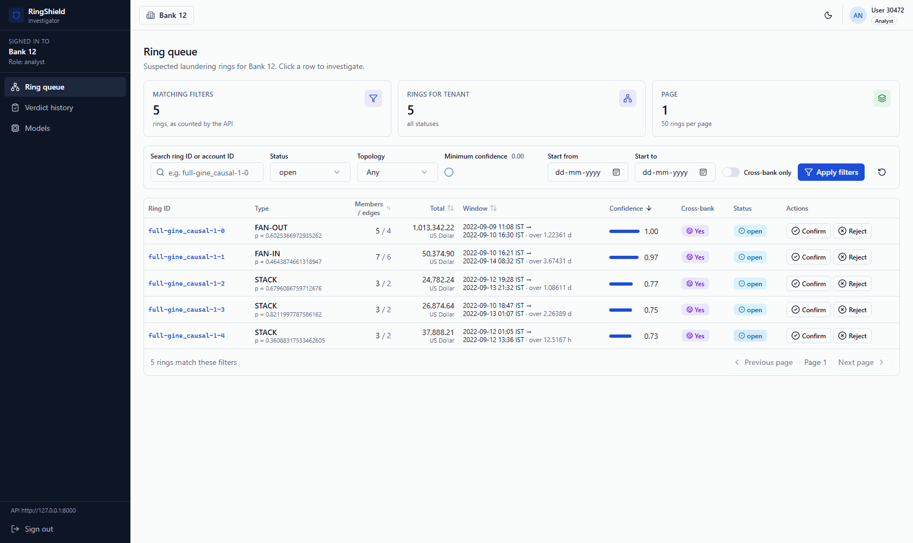
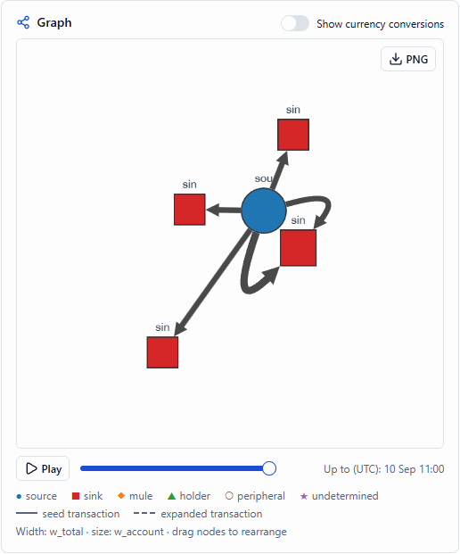
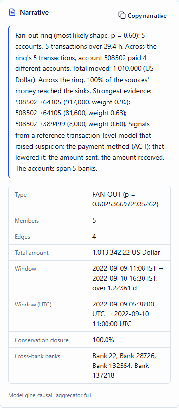
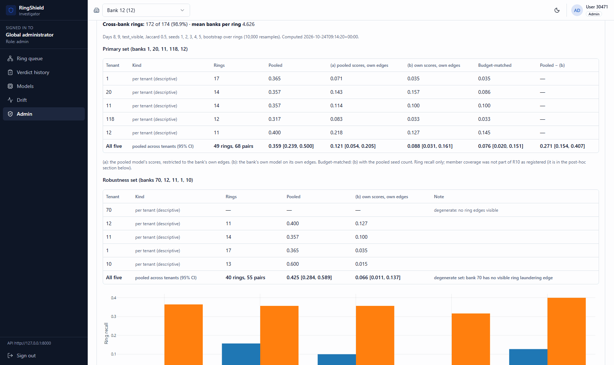

# RingShield

RingShield detects money-laundering **rings** — groups of accounts working together through
fan-out, fan-in, gather-scatter, cycle and stack patterns — instead of flagging single
transactions. A causal Multi-GINe graph neural network scores every transaction of the IBM
AMLworld HI-Small dataset; the top-scoring ones seed candidate rings, which a learned policy
expands and partitions into separate laundering attempts. Each ring carries account roles, a
pattern type and a traceable explanation, and an investigator works the rings in a
multi-bank dashboard. The full pipeline reaches ring-F1 **0.589** and raises recovery of ring
members the detector never flags from 0.5 % to 21 % (`docs/FINDINGS.md` A).

## What it looks like

| Ring queue (analyst, bank 12) | Ring detail: the graph |
|---|---|
|  |  |
| **The L4 narrative** | **Administrator: tenant vs pooled (R10)** |
|  |  |

Every screen, in light and dark, with what each one shows: **[docs/SCREENSHOTS.md](docs/SCREENSHOTS.md)**.

## Quickstart

On Windows 11 with Python 3.12, Node.js 18+ and Docker Desktop installed, and the data in place
(see [Data](#data)):

```bash
.\scripts\bootstrap.ps1
.\scripts\demo.ps1 -FromProcessedData
```

The first creates the Python environments from exact pins; the second runs the whole chain —
processed data → rings → L4 explanations → database → API → React dashboard — and prints the URL
(http://localhost:5173) and the demo logins. Without `-FromProcessedData` it loads the seed-1
rings and explanations already built. Stop it with `.\scripts\run-demo.ps1 -Down`.

## Where things live

- **Claims:** [`docs/FINDINGS.md`](docs/FINDINGS.md) — A: what the pipeline achieves, B: what it
  does not, C: measurement findings about the dataset. Nothing in this README goes beyond it.
- **Commands:** [`docs/REPRODUCE.md`](docs/REPRODUCE.md), including the end-to-end check of this
  integration. **Traps:** [`docs/PITFALLS.md`](docs/PITFALLS.md).
- **Experiment numbering:** E1–E3 are the Elliptic baselines (Phase 0–3, [`elliptic/`](elliptic/README.md)),
  E5–E7 the AMLworld edge-level experiments, R1–R12 the ring-level ones.

## What is implemented

Everything below exists in the repo and has been run on this workstation (RTX A5000). **Every
number in `results/` recomputes from an `experiments/<run>/metrics.json`** — `evaluation/audit_tables.py`
checks 18 headline rows mechanically and currently reports *18 traceable, 0 mismatched*.

Claims live in one place: **`docs/FINDINGS.md`** (A: what the pipeline achieves, B: what it does
not, C: measurement findings about the dataset). Commands live in **`docs/REPRODUCE.md`**.
Traps live in **`docs/PITFALLS.md`**.

### Pipeline

| Layer | What it does | Entry point | Output |
|---|---|---|---|
| L0 preprocessing | raw CSV → splits, ring ground truth, GFP motif features; stable `edge_id` by mergesort, hash-pinned | `scripts/format_kaggle_files.py`, `preprocessing/amlworld_loader.py`, `graph/motif_features.py` | `data/processed/` |
| L1 detector | Multi-GINe edge classifier, causal neighbour sampling, 5 seeds | `models/tgn.py --causal` | `experiments/R1_gine_causal` |
| L1 scoring / calibration | split scoring + head-input embeddings; isotonic fitted on val only | `models/score.py`, `models/calibrate.py` | `scores_*.parquet`, `calibrator_seed*.pkl` |
| L2 seeds | strict quantile cut at the val-chosen k\* (0.1 % / `min_size` 3) | `configs/threshold_rule.yaml` | — |
| L3a expansion | candidate generation + LightGBM policy trained on **cross-scored** train data | `ringshield/expand/` | `experiments/R3_expansion` |
| L3b partition | shared-account pair affinity + average linkage | `ringshield/partition/` | `experiments/R4_partition` |
| L3c roles / typing | account roles (source / sink / mule / holder / peripheral), ring confidence, topology head | `ringshield/roles.py`, `ringshield/typing/` | `experiments/R5_typing` |
| **L4 explainability** | **L4 explains rings, not edges.** Edge weights combine the calibrated score, leave-one-out ring contribution via `rerun_ring`, and flow share; account weights and roles come from conservation; feature weights are SHAP on GFP+XGBoost over the seed edges; narratives are fixed templates whose every number traces to a stored value. **No attention weights, no language model.** Its measured claims are explanation fidelity@k (k = 3, 5, 10) against ground-truth ring edges versus random and score-only controls with bootstrap CIs; typology and role accuracy on matched rings; p95 latency under 2 s; and a 30-explanation internal review with Fleiss' κ, labelled internal rather than an analyst study. The results are in L4's own report (`explainability/report/xai_chapter.md`), not in `docs/FINDINGS.md`. | `explainability/` (branch `explainability-l4`) | `results/xai/`, `contract/out/xai/` |
| Contract | `scored_edges` and `rings` v1 parquets for the platform side | `contract/` | `contract/out/` |
| CLI | `run` / `train` / `eval` / `export-model` | `python -m ringshield` | `docs/CLI.md` |

### Experiments behind the reported tables

| ID | What | Result |
|---|---|---|
| **R1** | detector, 5 seeds, causal | primary-window edge F1 0.495 ± 0.027 (the whole test split reads higher, inflated by the tail: C1/C2) |
| **R2** | B0 ring baseline, 3 detectors | gine 0.521 ± 0.045, density 0.014 |
| **R3** | expansion: policy vs rule baselines vs ablations | proposed 0.582; **quiet-member recall 0.005 → 0.21** |
| **R4** | partition: 5 methods + CSGM | full 0.589; the stage is **not** significant on this detector |
| **R5** | roles and topology typing | head **0.599** [0.549, 0.648] vs rule 0.551 [0.499, 0.601] on the primary window (401 matched rings); 0.594 on `whole`: typing is not window-bounded (~~0.219~~ corrected 2026-10-22, found by Ruhani (L4 Week 5 check): the old lookup typed the wrong ring; B10, C3 withdrawn) |
| **R6** | detector swap: MEGA-GNN and GFP-XGBoost | **+9.4 edge-F1 points buys 0.000 ring-F1** |
| **R7** | held-out pattern types (3 arms) + LI-Small | transfer holds on CYCLE at undiminished precision |
| **R9** | statistics: bootstrap CIs, permutation tests, Holm | every table carries an interval |
| **R10** | tenant vs pooled: a pooled model applied to one bank's view (banks 1, 20, 11, 118, 12) | platform-side; registered in `docs/TENANT_SIZES.md`, result in `results/tables/r10_registered.md` (not in FINDINGS) |
| **R11b/c** | seed-budget reallocation (ensemble, per-account) | allocation is **not** the binding constraint |

### Headline findings

1. **Edge F1 is not a proxy for ring recovery.** MEGA-GNN beats our detector by 9.4 edge-F1 points
   and produces the same rings (0.5208 vs 0.5213). The two disagree on *which* edges to seed
   (Jaccard 0.415) and agree on how many rings a 0.1 % budget reaches (128.8 vs 129.6 of 174).
2. **Expansion recovers quiet members** — 0.5 % → 21 % — but a two-line rule matches it; the learned
   policy buys *purity* (0.926 vs 0.518 added-member precision), not recall.
3. **Most of the remaining loss is structural, but there is no `min_size` cap on recall.** 34 % of
   rings (60 of 174) have < 3 visible members, yet 11.4 of them per seed are still matched
   (~~"28 % below `min_size`, recall capped at 0.72"~~, retracted 2026-09-30: B7/B9). 19 % are
   untouched by the shipped pipeline (13.8 % with MEGA-GNN: B8), and **81.5 %** of the largest
   residual class is in a piece of the ring that is *disconnected inside the evaluation window* —
   100 % for STACK even across the whole test split.
4. **Both ends of the AMLworld timeline are generator artefacts**, reproduced in two releases: day 0
   holds ~34 % of training edges at 10× density, and the test tail collapses to a ~60 % base rate on
   ≤ 0.13 % of edges.

### Deliberately not done

* **Step 12 (structuring stress test)** — premise weakened by findings B13/B15; see `docs/REPRODUCE.md`.
* **LI-Small method numbers** — 38 matchable rings cannot separate any method; its scope, tail and
  day-0 analyses are the reported result.
* **`rings_full` for mega / gfpxgb** — the contract builder is pinned to the shipped detector and
  asserts it reproduces the R4 run. Those detectors are research comparisons under
  `experiments/R6_full/`, not contract deliveries.
* **SHAP over the expansion policy** — specified in the roadmap's XAI layer, not built. Leave-one-out answers the analyst's actual question ("what happens to this ring if this transaction is not real?") at 25 ms, whereas SHAP would explain a per-candidate probability the analyst never sees. That is a reframing of the scope, not a completion of it, and it is stated here rather than glossed.
* **The XAI layer is not in `docs/FINDINGS.md`** (see the L4 row). Its measurements are L4's own and there is no analyst study, so it is a delivered capability, not a validated explanation. The contract fields should not be read as evidence.
* EvolveGCN, GATv2, the escalation cascade, attention-based XAI — out of scope (Step 1).
* **Elliptic**: the Elliptic baselines (E1–E3, Phase 0–3) live in [`elliptic/`](elliptic/README.md) and are
  not part of the ring pipeline, because Elliptic has no ring labels.

Seeds come from `configs/seeds.yaml` (`[1, 2, 3, 4, 5]`), paths from `configs/paths.yaml`
(`$RINGSHIELD_PATHS` selects a per-dataset file). Pre-R1 runs used the seeds in their own
`config.yaml`.

## Setup

Windows 11, PowerShell. Install these yourself first:

| Tool | Version | Used for |
|---|---|---|
| Python | 3.12 (research), 3.11+ (platform) | everything |
| Node.js + npm | 18+ | the React dashboard |
| Docker Desktop | with Compose v2 | the demo and test Postgres |
| NVIDIA GPU + CUDA 12.1 | optional | retraining detectors (R1, R6); not needed for the demo or the tables |

The parts pin different versions of the same packages (pandas 3.0.5 / 2.3.3 / 2.2.3), so each has
its own environment. One script creates them all from exact pins, plus the front end's packages:

```bash
.\scripts\bootstrap.ps1
```

| Environment | Where | Pins | For |
|---|---|---|---|
| research | `.venv312` | `requirements-lock.txt` (what the shipped R4 runs recorded) | L0–L3, evaluation, tables |
| xai | `..\venv-xai` | `explainability/requirements-test.txt` | L4 and its service |
| platform | `..\venv-platform` | `requirements-dev.txt` | L5/L6 API, workers, tests |
| elliptic | `.venv-elliptic` | `elliptic/requirements.txt` | E1–E3 and the pyvis visualisations |

## Data

Nothing in `data/`, `contract/out/*.parquet` or `experiments/**/*.parquet` is committed.

1. **Raw data.** Download *IBM Transactions for Anti Money Laundering (AML)* from Kaggle
   (https://www.kaggle.com/datasets/ealtman2019/ibm-transactions-for-anti-money-laundering-aml). Put
   `HI-Small_Trans.csv`, `HI-Small_accounts.csv` and `HI-Small_Patterns.txt` in `data/raw/`.
2. **Preprocess** (about 45 minutes). This writes `data/processed/`:

   ```bash
   .\.venv312\Scripts\python.exe scripts/format_kaggle_files.py data/raw/HI-Small_Trans.csv
   .\.venv312\Scripts\python.exe -m preprocessing.amlworld_loader --dataset HI-Small
   .\.venv312\Scripts\python.exe graph/motif_features.py
   .\.venv312\Scripts\python.exe preprocessing/account_bank.py
   ```

3. **Check the data.** This must print `data manifest OK`. If it doesn't, every downstream score is
   keyed to the wrong `edge_id` (`docs/PITFALLS.md` §1):

   ```bash
   .\.venv312\Scripts\python.exe scripts/data_manifest.py --check
   ```

4. **Demo inputs.** `scripts/demo.ps1` reads five sets of files:
   - `contract/out/scored_edges_gine_causal_1.parquet` (with its `.log.json`)
   - each bank's rings, edge ids and explanations, in `data/platform_tenant_runs/gine_causal_seed1/`

   These are produced by R1 seed 1 → `contract/make_scored_edges.py` → the tenant ring build
   (`docs/TENANT_SIZES.md`) → L4 (`explainability/`, branch `explainability-l4`). They come from
   the handoff, not from a download. The script lists any file that is missing.

## Running the demo

One command, from the repository root. `scripts/demo.ps1` is the only entry point;
`run-demo.ps1` and `e2e_demo.ps1` are helpers it calls.

```bash
.\scripts\demo.ps1                       # loads the seed-1 rings and explanations already built
.\scripts\demo.ps1 -FromProcessedData    # first rebuilds each bank's rings and L4 explanations
```

With `-FromProcessedData` it first builds each bank's rings from its visible edges in
`data/processed/` and explains them with L4. It then does the following, in order:
1. Checks for Python, Node/npm and Docker (the demo Postgres runs in Docker), plus every input file. It prints everything that is missing and stops.
2. Starts an empty demo Postgres on `127.0.0.1:55433` and runs the migrations.
3. Loads the seed-1 rings and explanations for banks 12 and 20.
4. Creates the logins: analysts at banks 12 and 20, a supervisor at bank 12, and an administrator.
5. Starts the API (`127.0.0.1:8000`) and the worker supervisor.
6. Builds the React app and serves the production build.

At the end it prints the URL, **http://localhost:5173**, and the logins. Open the page at
`localhost`, not `127.0.0.1`: the API accepts only that origin. Every run starts from an empty
database. Stop everything with:

```bash
.\scripts\run-demo.ps1 -Down
```

Simulated verdicts and a refused retrain (checklist lines 5 and 6) need R11's history. Bank 12 holds
too few rings for a retrain, so this demo runs on bank 1, R11's bank (about 15 minutes more; no L4 service,
which knows banks 12 and 20 only):

```bash
.\scripts\demo.ps1 -Tenants 1 -SupervisorTenants 1 -InputsDir data/platform_tenant_runs/r11_seed1/T1 -ExplanationsDir platform/out/r11/xai -R11History
```

It also needs R11's inputs for bank 1 (`docs/R11.md`): the rings in `data/platform_tenant_runs/r11_seed1/T1/`,
`platform/out/r11/xai/explanations_1_1.parquet` and `data/tenant_visible/scored_edges_visible_1_gine_causal_1.parquet`.

Other banks, a different detector seed, or the frozen Streamlit dashboard: call
`scripts/run-demo.ps1` directly (`-Tenants`, `-PlatformConfig`, and without `-SkipStreamlit`).
To run the dashboard on fixtures, without the API, see `platform/frontend/README.md`. The
screen-by-screen walk-through is in `docs/dashboard_checklist.md`.

## Reproducing each table

Commands assume `$PY=.venv312/Scripts/python.exe` and `PYTHONIOENCODING=utf-8`, run from the
repository root. `docs/REPRODUCE.md` has every training command with measured runtimes. The
right-hand column is the slow part: the training that produces the run artefacts. The middle column
rebuilds the table from artefacts already in `experiments/`.

| Table | Rebuild the table | Runs it needs (`docs/REPRODUCE.md`) |
|---|---|---|
| `results/tables/r1_edge_metrics.csv` | `$PY evaluation/edge_metrics.py --table` | §2: R1 training, about 15 h |
| `results/tables/r2_ring_b0.csv` | `$PY evaluation/aggregate_results.py` | §3: `ringshield.run_rings`, 5 seeds |
| `results/tables/r3_expansion.csv` | `$PY evaluation/aggregate_expansion.py` | §4: cross-scoring (about 8 h), policy, `run_expand` |
| `results/tables/r4_partition.csv`, `r4_unmatched.csv` | `$PY evaluation/aggregate_partition.py`; `$PY evaluation/unmatched_rings.py` | §5: affinity, `run_partition` |
| `results/tables/r5_typing.csv` | `$PY evaluation/typing_eval.py` | §6: typing head |
| `r2_ci`, `r3_ci`, `r4_ci`, `r5_typing_ci`, `r9_*`, `*_pvalues` | `$PY -u evaluation/step9_tables.py`; `$PY evaluation/r9_robustness.py` | §7 (about 45 min) |
| `results/tables/r6_detector_swap.csv` | `$PY -u evaluation/r6_detector_swap.py` | §8: MEGA-GNN (about 18 h), GFP-XGBoost |
| `results/tables/r7_heldout.csv` | `$PY -u evaluation/r7_heldout.py` | §9: held-out policies |
| `results/tables/r_under_covered*.csv` | `$PY -u evaluation/under_covered.py` | §10 |
| `results/tables/r10_registered.{json,md}` | `$PY evaluation/r10_registered.py` | tenant ring builds (`docs/TENANT_SIZES.md`) |
| `results/platform/r11/five_seeds/` | `.\scripts\run-r11-seeds.ps1` (about 2 h; a fresh demo database per run) | `docs/R11.md` |
| `results/platform/r12/registered/`, `diagnosis/`, `amended/` | from `platform/`: `python -m experiments.r12_injected_shift --pattern CYCLE`, `python -m experiments.r12_diagnose`, `python -m experiments.r12_amended` | `docs/R12.md` |
| `results/figures/f1..f5` | `$PY evaluation/make_figures.py` | — |

Two checks tie the numbers to their sources:
- `$PY evaluation/audit_tables.py` re-derives the ring tables from the per-seed `metrics.json`.
- `results/FROZEN.json` holds every headline number in this README and its source. `tests/test_frozen.py` fails if any of them changes.

## Tests

```bash
.\.venv312\Scripts\python.exe -m pytest tests contract/tests -q
.\scripts\test-db.ps1      # with ..\venv-platform activated
```

The second command runs the platform suite, including the row-level-security tests, against a
throwaway Postgres.

L4's tests run in its own environment (they need `fastapi` and the L4 outputs under
`results/xai/`):

```bash
..\venv-xai\Scripts\python.exe -m pytest explainability/tests -q
```

For the front end:

```bash
npm --prefix platform/frontend run typecheck
npm --prefix platform/frontend test
npm --prefix platform/frontend run test:e2e
```

The front-end tests are typecheck, unit tests and Playwright, all on fixtures. `npm run screenshots`
re-captures `docs/screenshots/` from a running demo (`docs/SCREENSHOTS.md`).

CI (`.github/workflows/`) runs the platform suite against Postgres, the research and explainability
unit tests, and a check that no pull request adds or grows a file over 5 MB.

Research tests that need `data/processed/` skip when it is absent. A changed skip count matters
(`docs/PITFALLS.md` §8b).

## Hardware

All runs so far: Intel Xeon W-2295 (18C/36T, 3.0 GHz), 128 GB RAM, NVIDIA RTX A5000
(24 GB), Windows 11 Pro, Python 3.12.10, PyTorch 2.5.1+cu121, PyG 2.8.0, XGBoost 3.4.1.

## Repository layout

| Folder | What |
|---|---|
| `preprocessing/`, `graph/` | L0: AMLworld splits, ring ground truth, GFP motif features |
| `models/` | L1: the Multi-GINe detector, scoring, calibration; `models/artifacts/` the exported ring models |
| `baselines/` | GFP-XGBoost and the other comparison detectors |
| `ringshield/` | L2–L3: seeds, expansion, partition, roles, typing, and the `python -m ringshield` CLI |
| `evaluation/` | ring metrics, statistics, every table and figure builder |
| `contract/` | the `scored_edges` and `rings` parquet contract with the platform |
| `explainability/` | L4: edge, account and feature weights, narratives, the regeneration service |
| `platform/` | L5/L6: database, API, workers, the React dashboard (`platform/frontend/`) |
| `elliptic/` | Phase 0–3 Elliptic baselines E1–E3 (not part of the ring pipeline) |
| `configs/` | paths, seeds, evaluation windows, threshold rule |
| `data/` | raw and processed data, not committed (see [Data](#data)) |
| `experiments/` | run records of the HI-Small experiments (R1–R12): configs, metrics, logs |
| `experiments_hi_medium/` | the same run records for the HI-Medium replication (V3); its run configs record this path |
| `experiments_valrings/` | validation-split rings for L4 and the holdout; hash-checked manifests record this path |
| `results/` | tables, figures, L4 outputs and platform experiment results |
| `docs/` | findings, reproduction, design notes; `docs/specs/` the original specifications; `docs/archive/` superseded material |
| `scripts/` | the demo, bootstrap, data checks and CI helpers |
| `tests/` | research unit tests (the platform's are in `platform/tests/`) |
| `third_party/` | MEGA-GNN shims (the upstream clone is not committed) |

## Contributors

See [`CONTRIBUTORS.md`](CONTRIBUTORS.md): Joan Sara Joe (JSJ), Ruhani Kumar, Kashish Mittal and
Lakshmishree.
