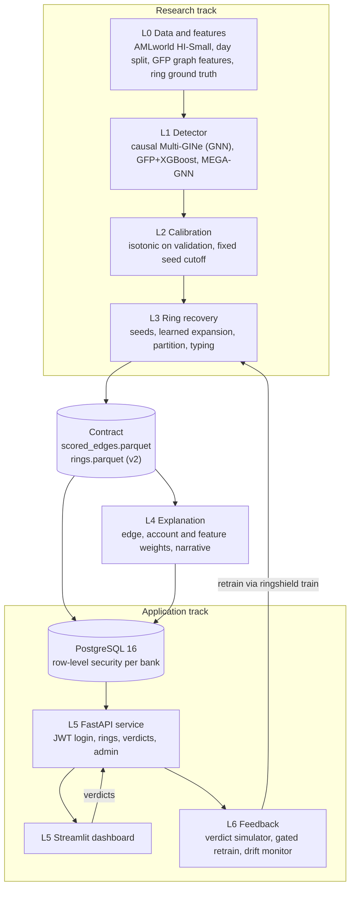
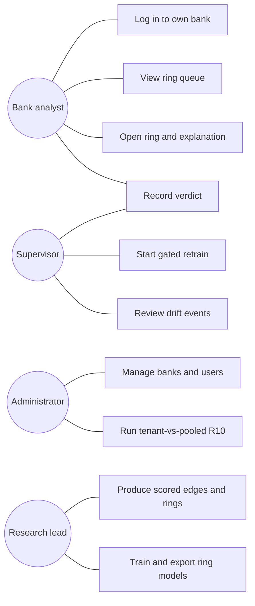
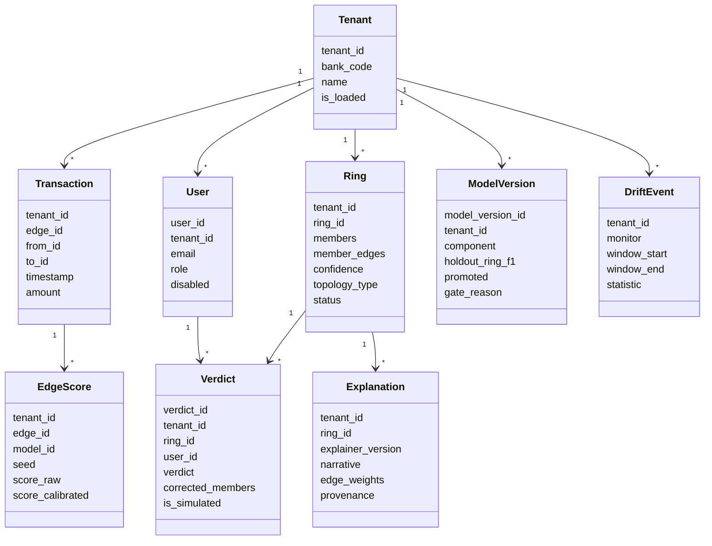
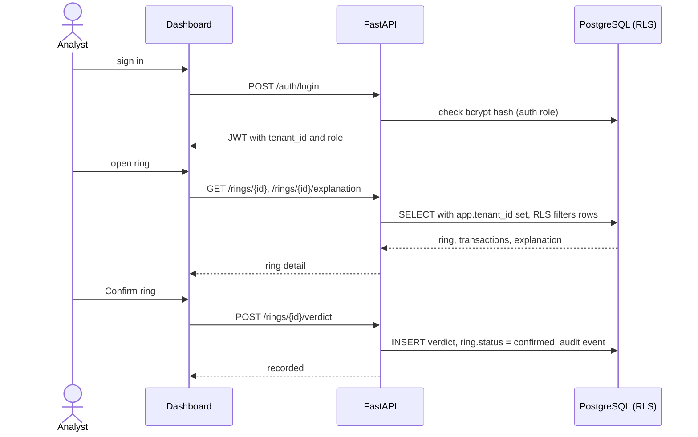
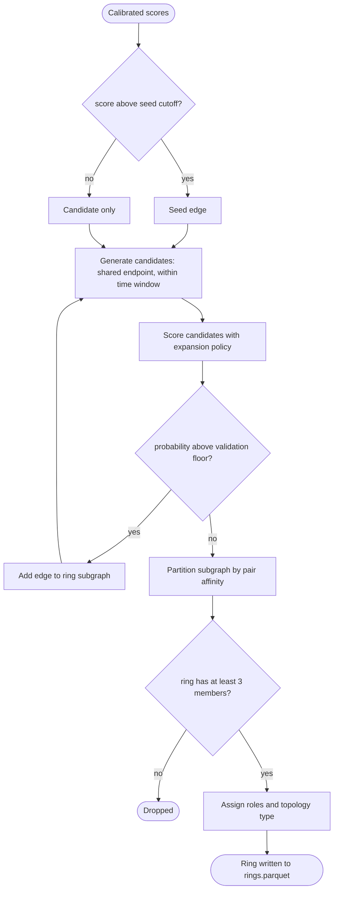
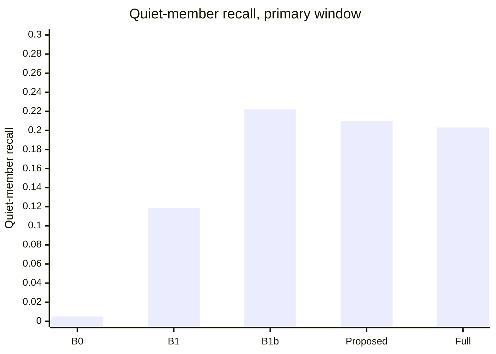
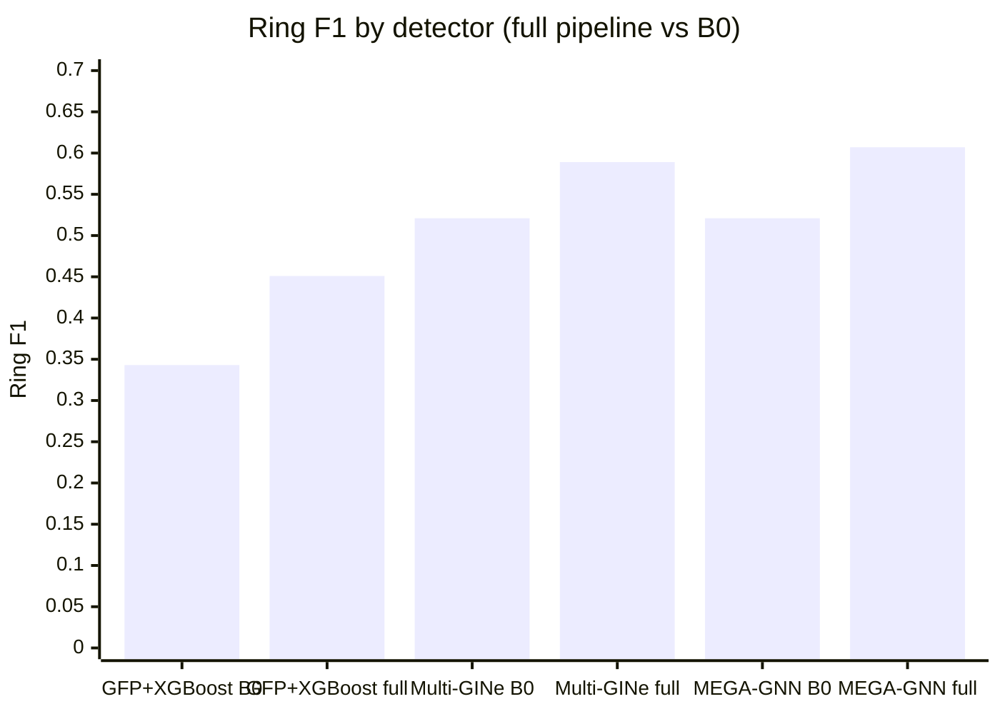

# RingShield: Ring-Level Money Laundering Detection with Explainable Alerts and Multi-Tenant Deployment

Chapters 3–8. Every number below comes from a file in this repository, named beside it; the
diagrams are Mermaid and render on GitHub.

---

# Chapter 3 System Design

## 3.1 Design Considerations

RingShield treats the **laundering ring**, not the transaction, as the unit of detection. A detector
scores every transaction; a ring layer grows rings from the most suspicious ones; an explanation layer
says why each ring was flagged; a multi-tenant platform serves the rings to bank analysts and takes
their verdicts back.

| Consideration | Decision | Why |
|---|---|---|
| Unit of detection | the ring (one laundering attempt) | investigators act on attempts; transaction-level scores miss the quiet middle accounts |
| No pre-filter cascade | every transaction reaches the ring layer | a filter that drops low scores drops exactly the quiet mule hops the ring layer recovers |
| Causality | a transaction's score and features use only earlier transactions | a forward-looking feature inflated earlier numbers 12–16× (`docs/FINDINGS.md` C4) |
| Selection on validation only | every threshold and model choice is made on validation days 6–7 | test-period tuning made earlier results unreliable |
| Evaluation window | primary window = test days 8–9 | days 10–17 have a 59 % positive rate and inflate every metric (C1) |
| One contract between tracks | two Parquet files, `scored_edges` and `rings` (schema v2, 30 columns) | research, explanation and platform work in parallel without editing each other's code |
| Tenant = bank | a bank sees a transaction if it is the sender's or the receiver's bank | isolation enforced by PostgreSQL row-level security, not by application code |
| Explanations | deterministic weights and fixed templates, no language model, no attention weights | every number in a narrative must trace to a stored value |
| Honesty in results | designs registered before runs; negative results reported as results | the experiment registry and `docs/FINDINGS.md` are the only source of reported numbers |

## 3.2 Architecture Diagram

Six layers. Data flows downward; only the two contract files cross from research to the application.

## 3.3 Data Flow Diagram / UML Diagram

**Data flow.**

```mermaid
flowchart LR
    T[/"HI-Small transactions<br/>5,078,345 rows"/] --> F["Format and split<br/>train d0-5, val d6-7, test d8-17"]
    F --> G["GFP features"]
    F --> D["Detector scores"]
    G --> D
    D --> K["Calibrated scores<br/>scored_edges.parquet"]
    K --> S["Seeds<br/>top 0.1 % on validation"]
    S --> E["Expansion<br/>quiet members"]
    E --> P["Partition<br/>one ring per attempt"]
    P --> Y["Typing<br/>8 pattern types"]
    Y --> R[/"rings.parquet"/]
    R --> X["Explanations"]
    R --> L["Platform loader"]
    X --> L
    L --> Q[("Per-bank tables")]
    Q --> A["Analyst queue"]
    A -->|confirm / reject / partial| V[("Verdicts")]
    V --> RT["Gated retrain"]
```

### 3.3.1 Use Case Diagram

### 3.3.2 Class Diagram

### 3.3.3 Sequence Diagram

An analyst confirms a ring.

### 3.3.4 Activity Diagram

How one ring is recovered from detector scores.

## 3.4 Module Description

| Module | Path | Responsibility |
|---|---|---|
| Data pipeline | `preprocessing/`, `scripts/format_kaggle_files.py` | format AMLworld, day split, bank ids, ring ground truth |
| Graph features | `graph/motif_features.py` | trailing fan-in/out, scatter/gather, temporal cycles (GFP) |
| Detectors | `models/`, `baselines/` | causal Multi-GINe, GFP+XGBoost, MEGA-GNN adapter |
| Ring layer | `ringshield/` | seeds, expansion (`expand/`), partition (`partition/`), roles, typing (`typing/`), CLI `python -m ringshield` |
| Evaluation | `evaluation/` | ring matching, bootstrap CIs, permutation tests, R10 |
| Contract | `contract/` | schemas of `scored_edges` and `rings`, FX rates, code maps |
| Explanation | `explainability/` | edge, account and feature weights, narratives, fidelity, review, regeneration service |
| Platform API | `platform/api/` | authentication, ring, verdict, admin and retrain routes |
| Database | `platform/db/` | SQLAlchemy models, Alembic migrations, roles and RLS |
| Jobs | `platform/jobs/` | loaders, tenant ring builder, simulator, retrain, drift monitor |
| Dashboard | `platform/dashboard/` | Streamlit investigator screens |
| Experiments | `platform/experiments/` | R11 and R12 harnesses |

---

# Chapter 4 System Requirement Specification

## 4.1 Software Requirement

| Area | Software | Version used |
|---|---|---|
| Operating system | Windows 11 Pro (WSL 2 for Docker) | 10.0.22621 |
| Language | Python | 3.12 (3.11 also tested for the explanation service) |
| Deep learning | PyTorch, PyTorch Geometric | 2.5.1 (CUDA 12.1), 2.8.0 |
| Gradient boosting | XGBoost, LightGBM | 3.4.1, 4.7.0 |
| Data | pandas, NumPy, PyArrow | 3.0.5, 2.5.3, 25.0.1 |
| Graph | NetworkX | 3.6.1 |
| ML utilities | scikit-learn, Optuna | 1.9.0, 5.0.0 |
| Explanations | SHAP | 0.50.0 |
| API | FastAPI, Uvicorn | 0.115.12, 0.34.0 |
| Database | PostgreSQL (Docker), SQLAlchemy, Alembic, psycopg | 16, 2.0.40, 1.15.2, 3.2.6 |
| Dashboard | Streamlit | 1.44.1 |
| Drift detection | river (ADWIN) | 0.22.0 |
| Scheduling, auth | APScheduler, bcrypt, JWT | 3.11.0, 5.0.0 |
| Containers | Docker Desktop with Compose | 29.9.2, Compose 5.6.1 |
| Testing | pytest; GitHub Actions CI | 8.3 / 9.1 |

The platform installs without PyTorch (`requirements-platform.txt`), so it runs on a laptop with no GPU.

## 4.2 Hardware Requirement

| | Used for development and experiments | Minimum for the platform demo |
|---|---|---|
| CPU | Intel Xeon W-2295, 18 cores / 36 threads | 4 cores |
| RAM | 128 GB | 16 GB (the explanation service peaks at about 2 GB) |
| GPU | NVIDIA RTX A5000 | none (only detector training uses the GPU) |
| Disk | 454 GB | about 20 GB for data, models and Docker images |

---

# Chapter 5 Implementation

## 5.1 Selection of Platform/Programming Language

**Python** for every layer: the graph-learning, gradient-boosting and explanation libraries are Python,
and one language lets the platform call the research code through a command-line contract.
**PyTorch Geometric** for the GNN detector (edge-level message passing with time-aware neighbour
sampling). **LightGBM** for the expansion and affinity models (fast on millions of tabular rows).
**PostgreSQL** because row-level security enforces tenant isolation inside the database, where an
application bug cannot bypass it. **FastAPI** for a typed, documented API; **Streamlit** for the
dashboard, because a Python team can build every required screen in it. **Docker** so the database
comes up the same way on every machine.

## 5.2 Model Implementation & Algorithm

**Detector (L1).** A Multi-GINe graph neural network with port numbering, time deltas, reverse message
passing, ego identifiers and GFP edge features. Neighbour sampling is causal: a transaction's
neighbourhood holds only earlier transactions. Trained on 5 seeds.

**Calibration (L2).** Isotonic regression fitted on validation turns raw scores into comparable
probabilities. The seed rule — the top k % of scores — is chosen on validation; every seed chose
k = 0.1 %.

**Ring recovery (L3).**

1. *Seeds*: edges above the seed cutoff.
2. *Expansion*: candidates share an endpoint with a ring edge within a time window Δt. A LightGBM
   policy scores each candidate on time gap, money-conservation gap, direction consistency, path to
   another seed, embedding similarity and windowed account statistics. It never uses the candidate's
   own detector score. Expansion stops when no candidate passes a validation-chosen floor.
3. *Partition*: a LightGBM affinity model scores pairs of ring edges that share an account; average-
   linkage clustering cuts the result into one ring per attempt.
4. *Typing*: a classifier over role counts, depth, cycle presence and size assigns one of eight
   AMLworld patterns (FAN-OUT, FAN-IN, GATHER-SCATTER, SCATTER-GATHER, CYCLE, RANDOM, BIPARTITE,
   STACK).

**Explanation (L4).** Edge weight = a mix of calibrated score and flow share (α = 0.6, γ = 0.4, chosen on
validation fidelity); leave-one-out ring confidence is computed and recorded. Account weights come from
conservation roles (source, sink, mule, holder, peripheral, undetermined). Feature weights are SHAP
values of the GFP+XGBoost model on the seed edges. A fixed template turns the weights into a
narrative.

**Feedback (L6).** Verdicts become training labels; `ringshield train` refits expansion and affinity;
the candidate is promoted only if its ring-F1 on a frozen validation holdout is at least the current
value minus ε = 0.005.

## 5.3 Functional Description of Modules

| Module | Input | Output | Key function |
|---|---|---|---|
| `ringshield run` | scored edges, model directory, GFP, embeddings | `rings.parquet` + run log | builds rings; `--edge-subset --tenant-id` for one bank's view |
| `ringshield train` | verdict labels, their scores and rings | retrained model directory | real refit of expansion or affinity |
| `ringshield eval` | rings, truth, holdout | ring metrics JSON | the only code that computes ring numbers |
| `explainability.tenant` | a bank's rings and visible scores | explanations parquet + log | explains rings without mentioning hidden activity |
| `explainability.serve` | HTTP request with excluded members | one regenerated explanation | regenerates after a partial verdict |
| `jobs/build_tenant_rings.py` | scores, bank id | the bank's edge subset and rings | applies the fixed pooled cutoff to a bank |
| `jobs/load_contract.py`, `load_explanations.py` | contract files | database rows | idempotent, schema-checked loading |
| `api/routers/*` | HTTP requests with JWT | JSON | login, rings, evidence, verdicts, admin, retrain |
| `jobs/simulate_verdicts.py` | open rings, truth, accuracy | simulated verdicts | noisy-oracle analyst |
| `jobs/retrain.py` | new verdicts | model versions, gate decision | gated retraining |
| `jobs/drift_monitor.py` | hourly or daily score statistics | drift events | ADWIN on mean and p99 |
| `scripts/e2e_demo.ps1` | bank id | running database, API, dashboard | one-command end-to-end run |

---

# Chapter 6 System Testing

## 6.1 Overview

RingShield was tested at four levels, from single functions up to the whole system running on real
data. Every level ran on branch `jsj-testing1` (v2 with the platform `regen-api` and explanation
`explainability-l4` branches merged) on 24 October 2026.

| Level | What it checks | Tool | Result |
|---|---|---|---|
| Unit | functions in isolation, with fake databases and fake research CLIs | pytest, `platform/tests` (excluding `isolation/`) | 373 passed, 0 failed |
| Integration | the platform against a real PostgreSQL 16: migrations, row-level security, loaders, API | `scripts/test-db.ps1` (disposable Docker database) and GitHub Actions CI | 412 passed, 0 failed locally; CI green |
| End-to-end | rings → explanations → database → API → dashboard for one bank, by one command | `scripts/e2e_demo.ps1` | pass |
| Experiments | the platform's own experiments on real files: R10, R11, R12 | `evaluation/r10_registered.py`, `scripts/run-r11.ps1`, `experiments.r12_injected_shift` | R10 and R11 completed; R12 stopped at its positive control |

The research layer's own suite, `tests/`, passed 204 of 204 on the merged `final` branch. The
explanation layer's suite passed 192 tests; 86 failed because that branch still expects the old
22-column (v1) rings, and about 15 of those need generated files that are not in git.

**Environment.** Windows 11, Python 3.12 in three virtual environments (research, explanation,
platform), Docker Desktop on WSL 2 running PostgreSQL 16. Data: AMLworld HI-Small, detector seed 1
unless stated, evaluation on the primary window (test days 8–9).

**Approach.** Each experiment's design was committed before it was run (R10 in
`docs/TENANT_SIZES.md`, R11 in `docs/R11.md`, R12 in `docs/R12.md`). A failing test was traced to its
cause; a code defect was fixed with a regression test, and a limit of the data or design was reported
as a result rather than worked around.

**Defects found.** Running the system for real found ten defects the unit tests had missed, because
those tests used fake databases or fake research tools. Nine were fixed; the drift monitor (T-21,
D-10) is recorded as future work.

## 6.2 Test Cases

### Unit and integration

| ID | Objective | Steps | Expected | Actual | Status |
|---|---|---|---|---|---|
| T-01 | Platform unit suite passes | `pytest platform/tests --ignore=platform/tests/isolation` | all pass | 373 passed | Pass |
| T-02 | Database suite passes on real PostgreSQL | `scripts/test-db.ps1` | all pass | 412 passed | Pass |
| T-03 | Two banks cannot read each other's rows | RLS isolation tests (22 run against PostgreSQL in CI) | cross-tenant query returns nothing | 0 rows across tenants | Pass |
| T-04 | Rings in the current (v2, 30-column) format load | load bank 12's v2 rings and explanations | loaded | refused as "v1" until fixed (D-1) | Pass after fix |
| T-05 | Simulator can record a verdict | simulated partial verdict on a real database | verdict saved | "permission denied for table verdicts" until fixed (D-3) | Pass after fix |
| T-06 | Wrong verdicts cannot get a worse model promoted | unit test: flipped verdicts make the candidate worse on the holdout | gate refuses | refused; honest verdicts promoted | Pass |
| T-07 | Test database builds on a restricted network | build the test image on the college network | image builds | plain-HTTP Debian downloads timed out (D-4) | Pass after fix |

### End-to-end

| ID | Objective | Steps | Expected | Actual | Status |
|---|---|---|---|---|---|
| T-08 | Build a bank's rings from its visible edges | `build_tenant_rings.py --tenant-id 12` | 5 rings from 20,039 edges | 5 rings from 20,039 edges | Pass |
| T-09 | Explain every ring | `python -m explainability.tenant --bank 12` | all rings explained and reproduced | 5/5 explained, 5/5 reproduced | Pass |
| T-10 | One command runs the whole system | `scripts/e2e_demo.ps1 -Tenant 12` | API healthy, dashboard up | `/health` ok (database, file store); dashboard HTTP 200 | Pass |
| T-11 | Analyst sees a ring with its explanation | log in as bank 12 analyst, open a ring | accounts, transactions, explanation, verdict form | all shown | Pass |
| T-12 | Dashboard starts unattended | start Streamlit in the background | dashboard up | blocked on Streamlit's first-run email prompt until fixed (D-5) | Pass after fix |

### Experiments

| ID | Objective | Steps | Expected | Actual | Status |
|---|---|---|---|---|---|
| T-13 | R10: ring recall of a pooled model applied to one bank's view (includes distribution shift) | `evaluation/r10_registered.py`, 5 tenants, 5 seeds | table with 95 % CIs | tenant 0.088 [0.031, 0.161] vs pooled 0.359 [0.239, 0.500] | Pass |
| T-14 | R11: tenant selection rule | most seed-1 tenant rings in days 8–9 among banks 1, 20, 11, 118, 12 | one bank chosen | bank 1 (7 rings) | Pass |
| T-15 | R11: verdicts recorded each cycle | 12 four-hour cycles, 100 % review | verdicts in the database | 6 on day 8, 1 on day 9 | Pass after fix (D-6) |
| T-16 | R11: retrain uses the verdicts | one retrain after cycle 6 | trains on day 8's verdicts | skipped with "0 new labels" until fixed (D-7) | Pass after fix |
| T-17 | R11: real trainer runs from the platform | `ringshield train` through the platform adapter | candidate model written | refused for missing inputs until fixed (D-8) | Pass after fix |
| T-18 | R11: platform reads what the model trained on | read `training_labels.rings` | ring ids read | rejected the trainer's records until fixed (D-9) | Pass after fix |
| T-19 | R11: gate decides on the frozen holdout | candidate vs base (0.6883), ε = 0.005 | promote or refuse with a reason | all four candidates refused; base model kept | Pass |
| T-20 | R11 is reproducible | run a = 0.90 twice | same numbers | identical | Pass |
| T-21 | R12: drift monitor fires on a synthetic step | +3 SD step from hour 12 of day 9, 48 hourly steps | detected | not detected (D-10) | **Fail** — R12 stopped as registered |

### Defects found and fixed

| ID | Defect | Effect | Fix |
|---|---|---|---|
| D-1 | Ring-format check compared columns with the new list for both versions | every current ring file was refused | compare with the v1 and v2 column lists |
| D-2 | Demo runner required exactly 5 rings for every bank | only banks 12 and 20 could be loaded | apply the count to those two only |
| D-3 | Simulator had insert but not read permission on verdicts | simulated verdicts failed on a real database | migration 0010 grants read on the two returned columns |
| D-4 | Test image fetched Debian packages over plain HTTP | build failed on restricted networks | HTTPS sources, pip retries |
| D-5 | Streamlit waits for an email on first run | background dashboard never started | write an empty credentials file before start |
| D-6 | Verdicts saved the verb ("confirm") as the ring status | every confirm or reject failed, including the dashboard buttons | map to "confirmed" / "rejected" |
| D-7 | First retrain stamped the base model with the current time | no earlier verdict ever counted as new | use the base model file's time |
| D-8 | Platform called the trainer without its required inputs | every real retrain failed | pass scores, rings, features and embeddings |
| D-9 | Platform expected plain ring ids from the trainer | every real retrain failed | read the trainer's ring records |
| D-10 | Drift monitor checks only every 32 updates; the calibrated p99 is flat | it cannot fire within the test period | **open** — future work F8 |

---

# Chapter 7 Results and Analysis

All results: AMLworld HI-Small, primary window (test days 8–9, 174 in-scope truth rings), `test_visible`
scope, Jaccard ≥ 0.5 matching, 5 detector seeds, 95 % bootstrap intervals over truth rings (1,000
resamples unless stated). Source: `docs/FINDINGS.md` and `results/tables/`.

## 7.1 Evaluation Metrics

| Metric | Definition |
|---|---|
| Edge F1, AP, ROC-AUC | per-transaction detector quality on the laundering class |
| Ring precision / recall / F1 | predicted rings matched one-to-one to truth rings at Jaccard ≥ 0.5 |
| Member coverage | share of a matched truth ring's members the prediction holds |
| Quiet-member recall | recall of ring members none of whose transactions reached the seed cutoff — the number that answers "does the ring layer find the hidden middle?" |
| Typology accuracy | correct pattern type on matched rings |
| Explanation fidelity@k | overlap of the top-k weighted edges with the true ring's edges, k = 3, 5, 10 |
| Fleiss' κ | agreement of three reviewers beyond chance |
| Latency | time to explain one ring (target p95 < 2 s) |
| Per-tenant vs pooled recall | ring recall a bank achieves on its own view vs the whole graph (R10) |

Significance: paired sign-flip permutation tests on per-ring matched indicators, 10,000 permutations,
Holm-corrected across the five pre-registered comparisons.

## 7.2 Output/Results

**Detector (R1).** Causal Multi-GINe, 5 seeds: primary-window edge F1 **0.495 ± 0.027**, ROC-AUC
**0.965**, average precision 405 × the positive rate (`results/tables/r1_edge_metrics.csv`).

**Ring recovery (R2–R4).**

| Method | Ring precision | Ring recall | Ring F1 [95 % CI] | Member coverage | Quiet-member recall |
|---|---:|---:|---|---:|---:|
| B0: seeds + connected components | 0.814 | 0.384 | 0.521 [0.429, 0.607] | 0.866 | 0.005 |
| B1: fixed expansion rule | 0.171 | 0.162 | 0.162 [0.118, 0.213] | 0.970 | 0.119 |
| B1b: rule + score quantile | 0.702 | 0.463 | 0.555 [0.470, 0.632] | 0.943 | 0.222 |
| Learned expansion (proposed) | 0.838 | 0.446 | 0.582 [0.490, 0.668] | 0.942 | 0.210 |
| **Full pipeline (expansion + partition)** | **0.818** | **0.461** | **0.589 [0.502, 0.675]** | **0.944** | **0.203** |

Source: `results/tables/r9_ring_ci.csv`.

**Detection by ring type** (full pipeline, 5 seeds summed; `evaluation/unmatched_rings.py`):

| Pattern | Found | < 3 visible members, unmatched | Never flagged | Merged / partial | Found, % of found + never flagged + merged |
|---|---:|---:|---:|---:|---:|
| SCATTER-GATHER | 78 | 25 | 5 | 2 | 92 % |
| FAN-OUT | 64 | 24 | 6 | 6 | 84 % |
| GATHER-SCATTER | 117 | 43 | 17 | 8 | 82 % |
| FAN-IN | 56 | 21 | 12 | 1 | 81 % |
| CYCLE | 42 | 40 | 18 | 10 | 60 % |
| RANDOM | 35 | 25 | 21 | 4 | 58 % |
| BIPARTITE | 5 | 25 | 41 | 9 | 9 % |
| STACK | 4 | 40 | 46 | 20 | 6 % |

**Typing (R5).** The typing head is correct on **0.599** [0.549, 0.648] of 401 matched rings against
0.551 [0.499, 0.601] for the rule scorer (`results/tables/r5_typing_ci.csv`).

**Explanations (R9, explanation layer).**

| k | Proposed weights | Score only | Random |
|---:|---:|---:|---:|
| 3 | 0.900 | 0.901 | 0.879 |
| 5 | 0.881 | 0.891 | 0.874 |
| 10 | 0.890 | 0.890 | 0.882 |

Fidelity is high for every ranking because 343 of 401 matched ring-instances contain only true transactions once
currency conversions are removed, so no ranking can separate itself (`results/xai/fidelity.json`).
Latency: p50 **393 ms**, p95 **918 ms**, max 2,007 ms over 560 rings. Review of 30 explanations by the
three team members (an internal review, not an analyst study): named accounts correct 91 %
(κ = 0.863), stated shape plausible 53 % (κ = 0.598), evidence enough to start an investigation 100 %.

**Multi-tenant cost (R10).** Banks 1, 20, 11, 118, 12; 68 tenant-ring pairs; 10,000 bootstrap resamples
(`results/tables/r10_registered.md`).

| Row | Bank alone | Pooled | Pooled − bank |
|---|---|---|---|
| Primary: bank's own scores, features, embeddings | 0.088 [0.031, 0.161] | 0.359 [0.239, 0.500] | 0.271 [0.154, 0.407] |
| Pooled scores on the bank's edges | 0.121 [0.054, 0.205] | 0.359 | 0.238 [0.135, 0.363] |
| Matched seed budget | 0.076 [0.020, 0.151] | 0.359 | 0.282 [0.167, 0.417] |

172 of 174 in-scope rings (98.9 %) span more than one bank; a ring touches 4.6 banks on average.

**Feedback loop (R11)** and **drift (R12)** are reported in Chapter 6 (T-13 to T-21): the loop runs
end to end and the gate refused every candidate; the drift monitor cannot fire as configured.

## 7.3 Comparative Analysis

| Detector | Edge F1 (whole test split) | Ring F1, B0 | Ring F1, full | Quiet-member recall, full |
|---|---:|---:|---:|---:|
| GFP+XGBoost | 0.500 | 0.343 | 0.451 | 0.267 |
| Multi-GINe (shipped) | 0.596 | 0.521 | 0.589 | 0.203 |
| MEGA-GNN | 0.689 | 0.521 | 0.607 | 0.242 |

Source: `results/tables/r6_detector_swap.csv`.

1. **Edge F1 is not a proxy for ring recovery.** MEGA-GNN beats the shipped detector by 9.4 edge-F1 points
   and produces the same B0 rings (0.5208 vs 0.5213). The two seed different edges (seed Jaccard 0.415)
   but reach the same number of rings (128.8 vs 129.6 of 174): the 0.1 % seed budget is what binds.
2. **Expansion is the one significant step.** Quiet-member recall rises from 0.5 % to 21 % (p_holm 0.0005).
   A two-line rule reaches the same recall; the learned policy's gain is purity — 0.926 vs 0.518 of the
   members it adds are correct.
3. **Partitioning is not significant on the shipped detector** (+0.015 matched rate, p_holm 0.49); on
   MEGA-GNN, where rings are more often merged, it is (+0.017, p_holm 0.011).
4. **Most of the remaining loss is structural.** 34 % of rings (60 of 174) have fewer than 3 visible
   members, yet 11.4 of them per seed are still matched, so there is no `min_size` cap on recall
   (~~"28 % … capped near 0.72"~~, retracted 2026-09-30: FINDINGS B7/B9). 19 % are untouched by the
   shipped pipeline (13.8 % with MEGA-GNN, B8); 81.5 % of the largest residual class is disconnected
   inside the two-day window (100 % for STACK across the whole test split). Achieved recall is 0.46.
5. **One bank's view loses most rings.** A pooled model applied to one bank's view recovers 8.8 % of
   its tenant-ring pairs against 35.9 % pooled, pooled − (b) = 0.271 [0.154, 0.407]. This includes
   distribution shift, so it is not only the cost of seeing fewer edges; 172 of 174 rings cross banks.

---

# Chapter 8 Conclusion & Future Work

## 8.1 Conclusion

RingShield shows that a ring layer on top of a transaction detector recovers laundering attempts as
whole rings, including members the detector never flagged: quiet-member recall rises from 0.5 % to 21 %
and ring F1 from 0.521 to 0.589 on the reporting window. Each ring reaches the analyst with an
explanation that is deterministic and traceable, in under one second at p95. The system runs as a
multi-tenant prototype with database-enforced isolation, verified on a real PostgreSQL by 412 tests,
and as one command end to end.

The project also measured where ring recovery stops. A stronger detector buys no rings at a fixed seed
budget; most remaining misses are rings too small or too disconnected to observe in a two-day window;
and a pooled model applied to one bank's view recovers far fewer rings than the pooled view
(0.088 against 0.359), a gap that includes distribution shift. The feedback loop works end
to end but six verdicts cannot show an effect, and the drift monitor, as configured, cannot fire.

Limitations, in order: the data is synthetic (AMLworld HI-Small); a share of laundering transactions
belong to no pattern and cannot be recovered as rings; analyst feedback was simulated; drift was
injected, not observed.

## 8.2 Future Enhancements

From `docs/FUTURE_IMPLEMENTATIONS.md`:

| # | Enhancement | Targets | Upper bound on the gain |
|---|---|---|---|
| F1 | Link disconnected ring parts through signals other than transaction paths | under-covered rings, STACK | ≤ 6.8 rings per seed (≈ 3.9 recall points) |
| F2 | Larger seed budget (0.2 %) | rings no seed reaches | union bound 150.8 of 174 rings touched |
| F3 | Scoped policy relaxation for pass-through accounts | GATHER-SCATTER declines | ≤ 1.6 rings per seed |
| F4 | Detector-specific expansion policy; MEGA-GNN as the detector | detector swap | small (the budget binds) |
| F5 | Validation-ring bootstrap for the detector choice | detector choice | a missing interval |
| F6 | 30-ring explanation review with Fleiss' κ | explanation claims | done on `explainability-l4` |
| F7 | Larger AMLworld releases and real data | external validity | — |
| F8 | A drift monitor that can fire | L6 drift, R12 | — (test every update; use a statistic that varies) |

Platform work still open: the ring graph with role and weight encoding, a tenant-vs-pooled results
screen, a dedicated verdict history screen, audit events on every state change, and connecting the
explanation regeneration service so "Partially correct" works in the dashboard.
