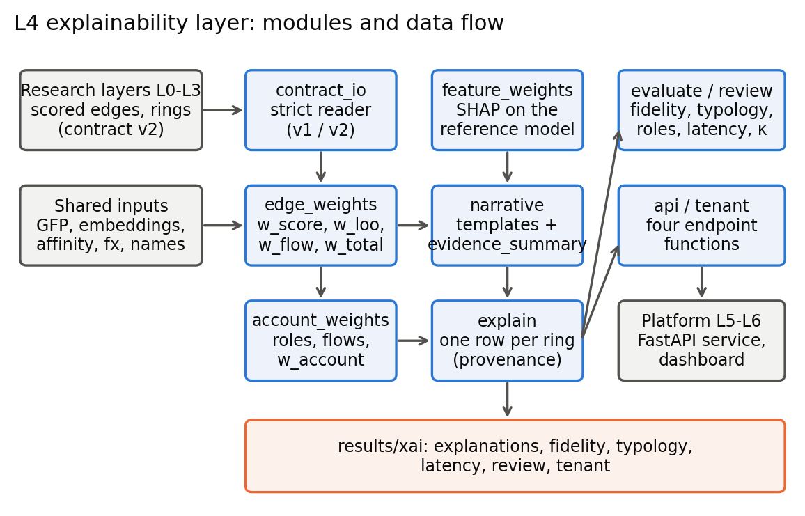
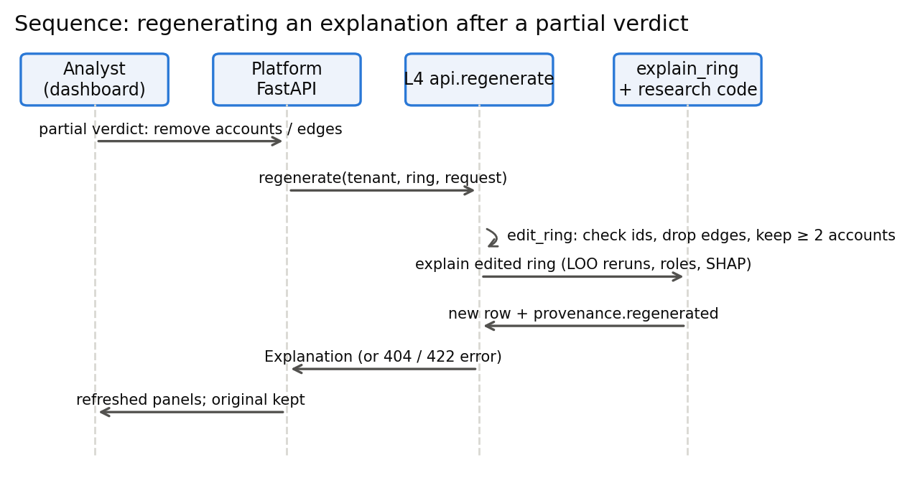
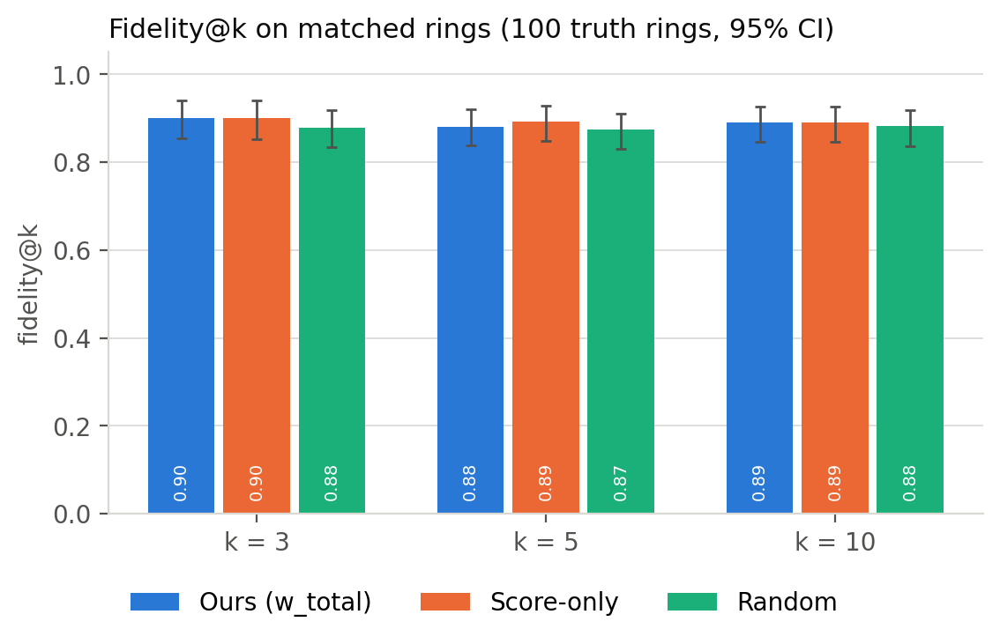
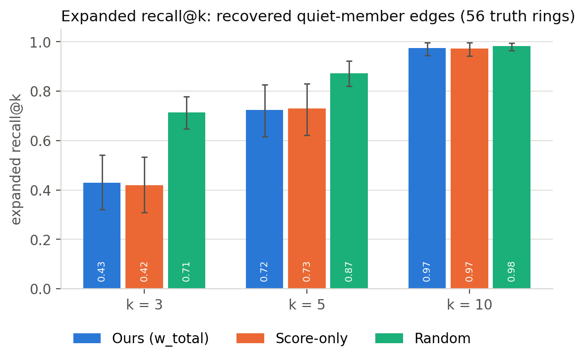
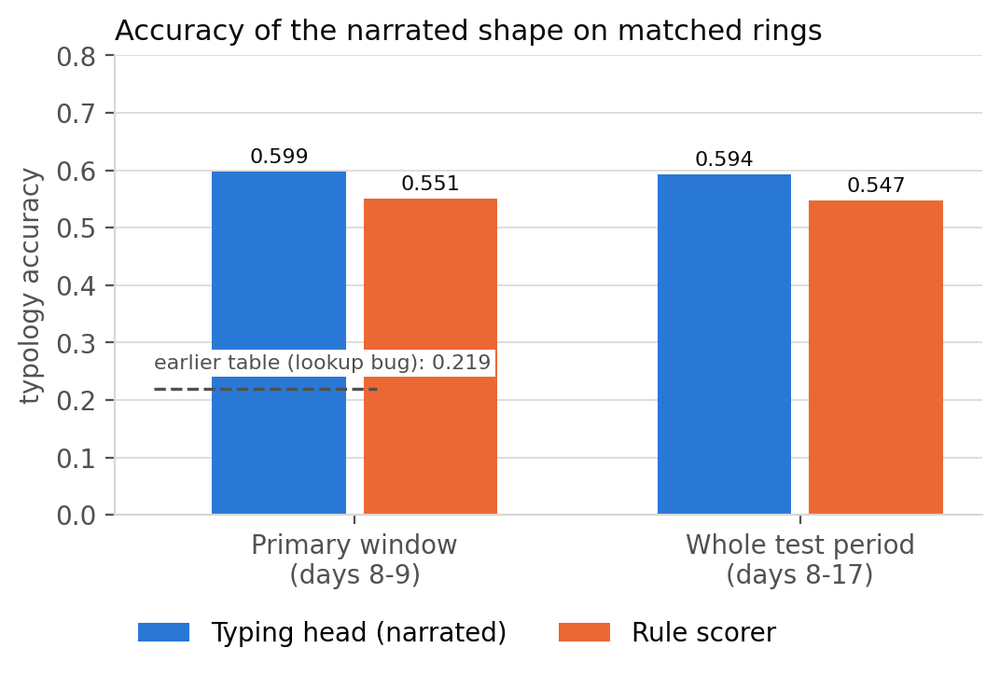
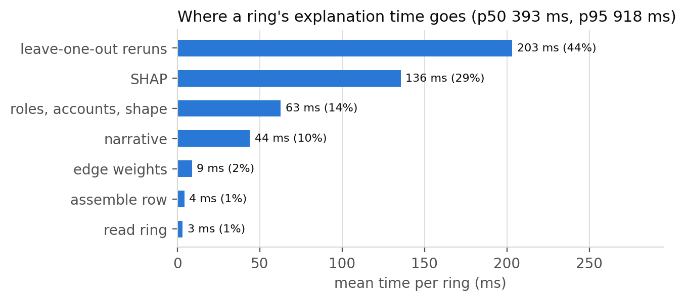
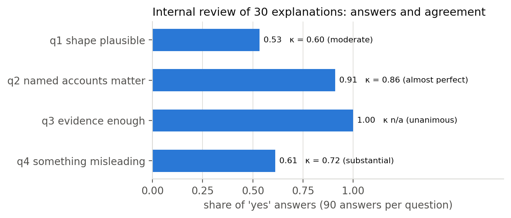
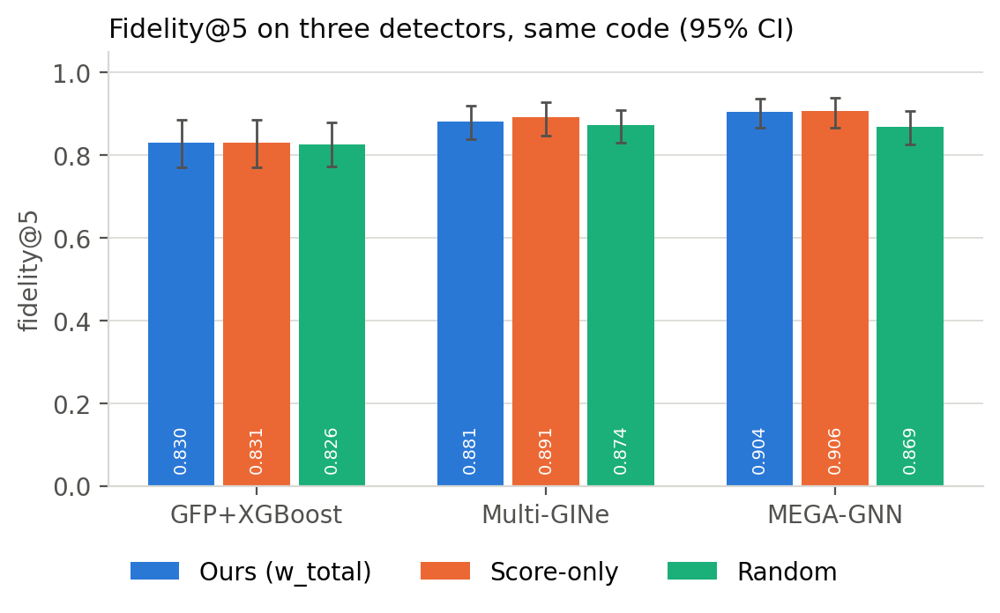

# RingShield — Explainability Layer (L4): Report Sections

*Draft for the research lead's review. Each part below is written to slot into the matching chapter of the project
report. Every number is taken from a file in `results/xai/`, and the file is named where the number appears.*

## 1 Introduction

### 1.1 Background / Domain Overview

A ring-level fraud detector flags groups of accounts rather than single payments. RingShield's research layers (L0–L3) score every transaction with a graph neural network, grow suspicious transactions into candidate rings, and assign each ring a probable shape such as fan-out or cycle. An investigator who receives such a ring still has to decide where to look first. Which payments carry the case, which accounts move the money, and why did the model raise the alarm at all? The explainability layer (L4) answers those questions for every ring and measures how good its answers are against the dataset's ground truth.

The data is AMLworld HI-Small, a synthetic anti-money-laundering dataset generated with known laundering patterns (Altman et al., 2023). Because the generator records which transactions belong to which laundering pattern, an explanation can be scored rather than judged by eye.

### 1.2 Problem Statement

Given a predicted ring and the scored transactions behind it, produce an explanation that (a) ranks the ring's transactions and accounts by how much they matter, (b) assigns each account a role in the flow of money, (c) names the transaction features that drove the detector, and (d) summarises all of this in a short sentence that an investigator can verify against the numbers. The explanation must be reproducible, must never rely on information the analyst cannot check, and must be evaluated quantitatively.

### 1.3 Objectives

- Weight every transaction in a ring by detector score, structural importance (leave-one-out) and share of money, and combine the three with weights tuned on validation data only.
- Infer account roles from money flows, converted to a single currency.
- Attribute the detector's suspicion to named features with SHAP.
- Generate a template narrative of at most 90 words whose every number can be regenerated from stored values.
- Evaluate fidelity against ground truth with confidence intervals and two controls, alongside typology accuracy, role accuracy, latency, and an internal human review.
- Deliver the explanations to the platform through four documented functions, including tenant-scoped explanations.

### 1.4 Scope of the Project

L4 starts at the research layers' contract files and ends at an explanation record per ring. It does not change the detector, the ring aggregator or the typing model, and it uses no attention weights and no language model. Tenant isolation is enforced by the platform; L4 also provides explanations computed only on a tenant's visible transactions when the platform asks for them.

### 1.5 Organization of the Report

The L4 material follows the report's structure: design (Chapter 3), requirements (Chapter 4), implementation (Chapter 5), testing (Chapter 6), results (Chapter 7) and conclusions (Chapter 8).

## 2 Literature Survey

### 2.1 Existing Methods / Previous Work

Post-hoc feature attribution for tree ensembles is commonly done with SHAP values, which split a model's output for one instance into additive per-feature contributions (Lundberg & Lee, 2017); for tree models the TreeExplainer algorithm computes them exactly (Lundberg et al., 2020). Graph-based fraud detectors are harder to explain at the level an investigator works with, since their attributions refer to individual edges or nodes rather than to a coordinated group. Agreement between human raters on categorical judgements is usually reported with Fleiss' kappa (Fleiss, 1971) and read on the Landis and Koch (1977) scale.

### 2.2 Research Gap Identified

Explanations of graph detectors are typically produced per transaction and assessed qualitatively. Ring-level explanations that are scored against known laundering structure, and that report negative findings as readily as positive ones, are much less common. L4 targets that gap: its explanations are ring-level by construction and every claim it makes is either regenerable from stored values or measured against ground truth.

## 3 System Design

### 3.1 Design Considerations

Four constraints shaped the design. The research layers own the data contract, so L4 reads their files through a strict reader and refuses anything that breaks the schema. Every explanation must be reproducible, so all randomness is seeded and each output row carries its provenance. The narrative may state only what the stored numbers support; it is a filled template rather than generated text. Finally, the platform must be able to call L4 without importing any model code of its own, which led to a small function interface with JSON schemas.

The dataset mixes fifteen currencies. Early in the project L4 discovered that the generator's cross-currency payments reveal fixed exchange rates, which the research lead then published; all amounts are converted to US dollars before any sum, and currency conversions (an account changing its own money) are excluded from the evidence because none of the 72,170 in the dataset is laundering.

### 3.2 Architecture Diagram

Figure 1 shows the modules and the direction of data flow.

### 3.3 Data Flow / UML Diagrams

#### 3.3.1 Use Case

An investigator opens a ring and reads its narrative, the strongest transactions and the account roles. After reviewing the evidence the investigator may record a partial verdict that removes accounts or transactions; the explanation is then regenerated for the corrected ring. A supervisor or researcher runs the evaluation to obtain fidelity, typology, role and latency figures.

#### 3.3.2 Class Structure

| Module | Main elements | Responsibility |
|---|---|---|
| `contract_io` | `read_rings`, `read_scored_edges`, `detector_cfg` | strict contract reading (schema v1/v2), per-detector configuration |
| `edge_weights` | `LooInputs`, `w_loo`, `edge_weight_table` | transaction weights and their mix |
| `account_weights` | `research_roles`, `account_weight_table` | roles, money flows, account weights |
| `feature_weights` | `FeatureExplainer`, `ring_feature_weights` | SHAP on the reference transaction-level model |
| `narrative` | `narrative_values`, `build_narrative`, `regenerate` | template narrative and its evidence summary |
| `explain` | `ExplainContext`, `explain_ring`, `run_file` | one explanation row per ring |
| `evaluate`, `stats` | `week4_report`, `typology_report`, `bootstrap_mean` | fidelity, typology, roles, statistics |
| `api`, `api_schemas`, `tenant` | `ExplanationService`, `TenantExplainer` | platform interface, tenant-scoped explanations |
| `review` | `sample`, `aggregate`, `before_after` | the internal review of thirty explanations |

#### 3.3.3 Sequence Diagram

Figure 2 traces a regeneration after a partial verdict.

#### 3.3.4 Activity

For each ring, `explain_ring` reads the ring, reruns the grouping without each of its seed and expanded transactions, builds the weight table, infers roles and account weights, computes SHAP on the seed transactions, assembles the narrative values, renders the narrative and writes the row with its provenance and latency.

### 3.4 Module Description

The reader validates every ring against the contract (seed and expanded transactions are members, topology probabilities sum to one, every account in a role list is a member) before anything is computed. The edge-weight module combines three signals. The account module asks the research layer's role function for each account's role and adds an account weight. The feature module explains the separate GFP+XGBoost reference model, chosen because its 17 inputs have names. The narrative module turns stored values into a sentence and keeps every substituted value. The evaluation modules compare all of this with the ground truth.

## 4 System Requirement Specification

### 4.1 Software Requirements

Python 3.11.9 with numpy 2.2.5, pandas 2.3.3, pyarrow 22.0.0, xgboost 3.2.0, shap 0.50.0, networkx 3.6.1, scipy 1.16.3 and pydantic 2 (versions as recorded in `latency.json`). The research repository's `contract`, `ringshield` and `baselines` packages are imported, not copied. FastAPI and httpx are used only by the tests that exercise the endpoints.

### 4.2 Hardware Requirements

All timings were measured on a single laptop: an AMD processor with 8 cores and 16 threads and 15.4 GB of RAM, running Windows 11, in one process. No GPU is needed by L4.

## 5 Implementation

### 5.1 Selection of Platform / Programming Language

Python was the natural choice because the research layers, the SHAP implementation and the data tooling are all Python. Parquet files carry every intermediate result, so the layer reads and writes the same columnar format as the rest of the system.

### 5.2 Model Implementation & Algorithm

**Transaction weights.** For each evidence transaction *e* of a ring:

- *w_score(e)* is the detector's calibrated score;
- *w_loo(e)* measures how much the ring depends on *e*. The ring's grouping is rerun without *e* using the research layer's own rerunner with the same features, embeddings and affinity model; the drop in ring confidence plus 0.5 if removing *e* disconnects the ring is scaled to [0, 1];
- *w_flow(e)* is *e*'s share of the ring's money in US dollars;
- *w_total = α·w_score + β·w_loo + γ·w_flow*.

The mixing weights were chosen on validation rings only, over a grid of 66 combinations, and fixed before any test-period result was read. The choice was (0.6, 0.0, 0.4) (`xr05_mixing_choice.json`). Leave-one-out received zero weight; the whole grid spanned only 0.025 in validation fidelity, and just 89 of 431 matched validation rings could separate one ordering from another, so the choice was weakly determined.

**Roles.** Each account's inflow and outflow are booked in their own currency, converted to US dollars, and classified with the research layer's rule: source, sink, mule, holder, peripheral, or undetermined when an account touches Bitcoin, whose exchange rate cannot be recovered.

**Feature attribution.** SHAP values are computed exactly with TreeExplainer on the reference model of the same seed. The model's inputs are rebuilt from the split and graph-feature files and checked against the shipped scores (maximum difference 0 on every seed transaction of all five seeds). The base value is taken from XGBoost's own decomposition because shap 0.50 misreads the stored base score of XGBoost 3 models.

**Narrative.** A narrative is assembled from clauses, each of which is used only when every value it needs exists. Amounts are given to three significant figures and lists are capped at three items. If the text exceeds 90 words, optional clauses are removed in a fixed order. Every substituted value is stored in `evidence_summary`, and a regeneration function rebuilds the sentence from those values alone; a test requires the two to match character for character.

**Fixes from the review.** The internal review (Section 7.2.4) led to four wording changes in Week 8. A shape that the ring's transactions do not show is now stated as the typing model's guess rather than as the headline. Shape sentences and the conservation figure state that they cover the whole ring. A shape sentence is stated only when the hub account's money role agrees with it. A payment from an account to itself is no longer cited as evidence. None of these changes touches a weight, an evidence ranking or a fidelity number.

### 5.3 Functional Description of Modules

`explain` writes one row per ring with the edge weights, account weights, top-10 feature weights, topology and its probability, the narrative, the evidence summary, the latency and a provenance record. `evaluate` produces `fidelity.json`, `typology_eval.json` and the role-accuracy section. `api` exposes `get_explanation`, `get_evidence_edges`, `get_evidence_accounts` and `regenerate`; an unknown ring and another tenant's ring return the same "not found" so that a caller cannot learn whether another bank's ring exists. `tenant` explains rings built by the platform for one bank using only the transactions that bank can see; graph features for the SHAP step are recomputed on that bank's visible history with the research layer's own functions, which were first shown to reproduce the shipped feature file exactly.

## 6 System Testing

### 6.1 Overview

The layer is covered by an automated suite of 288 tests, run with pandas deprecation warnings treated as errors; all pass. Tests fall into four groups: contract and schema checks, hand-computed cases whose answers were worked out on paper, reproduction tests that require the code to match an independent source exactly, and end-to-end checks on the real files of all detectors and tenants.

### 6.2 Test Cases

| ID | Test | Input | Expected result | Outcome |
|---|---|---|---|---|
| T1 | A missing contract column is refused | rings file with one column removed (each of 30) | named error | pass |
| T2 | Five-transaction ring by hand | fixture with known weights | w_loo and w_total to 1e-6 | pass |
| T3 | Mixed-currency money share | fixture in euro, US dollar and Bitcoin | shares sum to 1 over convertible transactions; ring marked partial | pass |
| T4 | Leave-one-out is not degraded | every ring of all detectors | rerunner reports no missing feature | pass |
| T5 | SHAP adds up | every seed transaction of seed 1 | base + contributions = model output (to 1e-3) | pass |
| T6 | Narrative regenerates | every narrative in every file | rebuilt text identical to stored text | pass |
| T7 | At most 90 words, no blanks | every narrative | no "None", "nan" or empty slot; ≤ 90 words | pass |
| T8 | Statistics match the research code | the research lead's evidence objects | bootstrap interval and permutation p-value identical | pass |
| T9 | Typology lookup | research table reproduced with its own lookup | identical to the published table; by-id lookup types the matched ring | pass |
| T10 | Mixing chosen on validation only | the stored choice | no test file read; latest timestamp before the test period | pass |
| T11 | Regenerate after removing a member | stub ring, one sink removed | account and its transactions gone; weights change; same output twice | pass |
| T12 | Tenant visibility | every tenant explanation | no account or transaction outside the bank's view is mentioned | pass |
| T13 | No ground truth in any API response | every ring of six files | no truth field or account number present | pass |
| T14 | Review answer key never committed | the review folder | key is git-ignored; packets reveal no ring id or true type | pass |
| T15 | Review fixes do not move numbers | all explanation files before and after Week 8 | weights, feature weights and fidelity byte-identical | pass |

## 7 Results and Analysis

### 7.1 Evaluation Metrics

- **Fidelity@k:** the share of a ring's top-*k* ranked transactions that truly belong to the matched laundering pattern, divided by min(*k*, number of true transactions). Reported per truth ring with a 95 % bootstrap interval (1,000 resamples) and compared with a score-only ranking and a random ranking.
- **Expanded recall@k:** whether the transactions the ring layer recovered beyond the seeds (the "quiet members") appear in the top *k*.
- **Typology accuracy:** the share of matched rings whose narrated shape is the true pattern type.
- **Role precision and recall:** narrated roles against roles computed by the same code on the true ring's transactions.
- **Latency:** wall-clock time per ring, including every leave-one-out rerun and the SHAP call.
- **Review agreement:** Fleiss' kappa across three reviewers per question.

### 7.2 Output / Results

#### 7.2.1 Fidelity

Table 1 and Figure 3 give fidelity on the primary evaluation window (`fidelity.json`).

| ranking | @3 | @5 | @10 |
|---|---|---|---|
| ours (w_total) | 0.900 [0.854, 0.940] | 0.881 [0.838, 0.921] | 0.890 [0.846, 0.927] |
| score-only | 0.901 [0.852, 0.941] | 0.891 [0.848, 0.928] | 0.890 [0.846, 0.927] |
| random | 0.879 [0.834, 0.919] | 0.874 [0.830, 0.910] | 0.882 [0.837, 0.919] |

*Table 1. Fidelity@k, 100 truth rings, 95 % bootstrap intervals.*

The intervals overlap at every *k*, so the result is reported as negative: the mixed ranking is statistically indistinguishable from sorting by the detector score. The metric itself explains much of this. After conversions are removed, 343 of the 395 matched ring-instances with any true ranked transaction contain only true transactions, and in such a ring every ordering scores 1. Read the other way, the predicted rings are very clean.

#### 7.2.2 Expanded recall

The recovered quiet-member transactions rank below where a random order would put them (expanded recall@5: ours 0.724, score-only 0.729, random 0.873; Holm-corrected p < 0.001 against random). The cause is mechanical. Such transactions have low detector scores by construction, the tuned mix leans 0.6 on that score, and leave-one-out, the one signal that could lift a structurally important quiet transaction, received zero weight.

#### 7.2.3 Typology, roles and latency

The narrated shape matches the true pattern type for 0.599 of matched rings on the primary window and 0.594 over the whole test period (`typology_eval.json`). An earlier research table reported 0.219 on the primary window; L4 traced that figure to a lookup that typed a different ring than the matched one in 316 of 401 cases, and reproduced the published number exactly with the faulty lookup. When the narrative states a shape sentence that holds on the ring's transactions, the stated shape is right 0.649 of the time, against 0.529 when it does not.

For accounts present in both the predicted and the true ring, 82.8 % receive the same role (`fidelity.json`, `role_accuracy`). Headline precision is lower (source 0.61, sink 0.42, mule 0.25) because accounts that appear in only one of the two rings count as errors; recomputing roles on the evaluation window alone raises precision to 0.91–0.96.

Median latency is 393 ms per ring and the 95th percentile is 918 ms, within the 2,000 ms target; no ring exceeded 5 s (`latency.json`). Leave-one-out reruns account for 44 % of the time and SHAP for 29 %, and latency rises almost monotonically with the number of reruns (Spearman ρ = 0.98).

#### 7.2.4 Internal review of thirty explanations

Thirty matched rings, stratified by true pattern type, were reviewed by the three team members, each answering four yes/no questions without seeing the ground truth. This was a structured team check rather than an analyst study, and one reviewer also built the explanations. The rules for interpreting the answers were committed to the repository before two of the three answer sheets existed (`review/analysis_plan.md`).

| question | yes-rate | all three agree | Fleiss' κ |
|---|---|---|---|
| the stated shape is plausible | 0.53 | 70 % | 0.60 (moderate) |
| the named accounts are the ones that matter | 0.91 | 97 % | 0.86 (almost perfect) |
| the evidence is enough to start an investigation | 1.00 | 100 % | undefined (unanimous) |
| something in the sentence is misleading | 0.61 | 80 % | 0.72 (substantial) |

*Table 2. Review answers and agreement (`review/review_summary.md`).*

Reviewers found the evidence sufficient in every case and largely agreed on the accounts. The shape claim was the weak point. An exploratory breakdown, labelled as outside the analysis plan, showed that all thirteen narratives naming a shape without a supporting shape sentence were judged misleading, whether or not the shape was in fact correct. Follow-up comments on six further items pointed to claims that rested on transactions outside the five shown, to a hub whose money role contradicted the shape sentence, and to a self-payment cited as evidence. These findings produced the four wording fixes described in Section 5.2; `review/before_after.md` shows each of the thirty narratives before and after.

### 7.3 Comparative Analysis

| | Multi-GINe (shipped) | GFP+XGBoost | MEGA-GNN |
|---|---|---|---|
| rings explained | 560 / 560 | 873 / 873 | 579 / 579 |
| fidelity@5: ours / score / random | 0.881 / 0.891 / 0.874 | 0.830 / 0.831 / 0.826 | 0.904 / 0.906 / 0.869 |
| expanded recall@5: ours / score / random | 0.724 / 0.729 / 0.873 | 0.794 / 0.794 / 0.890 | 0.730 / 0.728 / 0.860 |
| typing accuracy (narrated) | 0.599 | 0.578 | 0.579 |
| role agreement, accounts in both rings | 0.828 | 0.769 | 0.824 |

*Table 3. The same code on three detectors (`xr36_detectors.json`).*

The layer ran unchanged on all three detectors. The pattern of results holds across them: fidelity is saturated, the mixed ranking ties the score-only control, recovered quiet members rank below random, and the narrated shape is right somewhat less than three times in five. That consistency suggests the findings reflect the explanation method and the evaluation design rather than a property of one detector.

## 8 Conclusion & Future Work

### 8.1 Conclusion

L4 delivers a scored, reproducible explanation for every predicted ring of three detectors, together with an interface the platform can call and tenant-scoped variants for individual banks. Its most useful results may be the negative ones. Fidelity on the specified metric could not separate the proposed ranking from the detector's own ordering; the quiet members that justify ring-level detection are under-ranked; and reviewers judged unsupported shape claims misleading even when the shape was correct. Each of these was measured, reported, and in the last case corrected.

### 8.2 Future Enhancements

- A ranking term that rewards structural importance independently of score, so that recovered quiet members can rise; leave-one-out exists but received no weight under the present tuning.
- A fidelity measure that does not saturate, for instance one computed only on rings whose ranked transactions mix true and false members, agreed with the research lead in advance.
- Typed shapes for tenant-built rings, by attaching the typing model in the platform's tenant build.
- A second review round on the revised narratives, ideally with analysts outside the team.

## References

- Altman, E., Blanuša, J., von Niederhäusern, L., Egressy, B., Anghel, A., & Atasu, K. (2023). Realistic synthetic financial transactions for anti-money laundering models. *Advances in Neural Information Processing Systems 36 (Datasets and Benchmarks Track)*.
- Fleiss, J. L. (1971). Measuring nominal scale agreement among many raters. *Psychological Bulletin, 76*(5), 378–382.
- Landis, J. R., & Koch, G. G. (1977). The measurement of observer agreement for categorical data. *Biometrics, 33*(1), 159–174.
- Lundberg, S. M., & Lee, S.-I. (2017). A unified approach to interpreting model predictions. *Advances in Neural Information Processing Systems 30*.
- Lundberg, S. M., Erion, G., Chen, H., DeGrave, A., Prutkin, J. M., Nair, B., Katz, R., Himmelfarb, J., Bansal, N., & Lee, S.-I. (2020). From local explanations to global understanding with explainable AI for trees. *Nature Machine Intelligence, 2*, 56–67.
